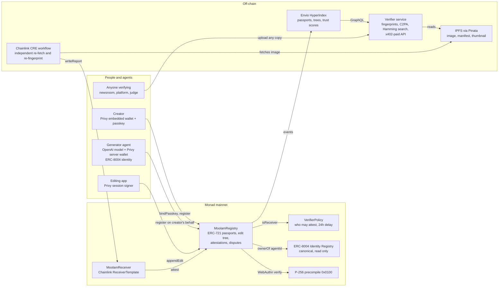
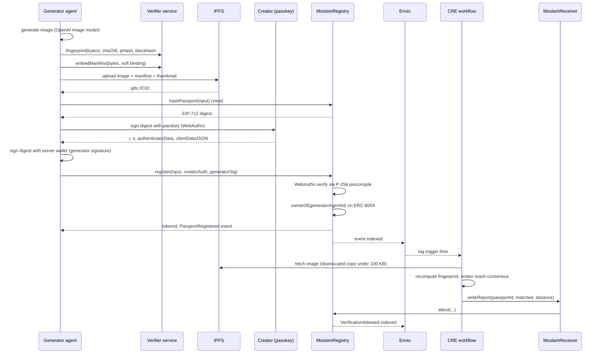
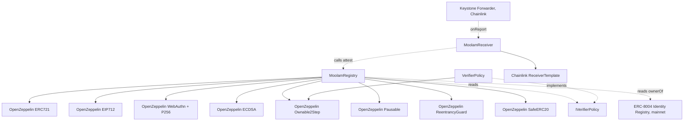

# Moolam architecture

Moolam gives every AI-generated image a passport on Monad: a permanent record of
the exact bytes, two perceptual fingerprints that survive re-encoding, the C2PA
manifest, the creator and the generator agent. Anyone can verify any copy, even
one a platform has stripped of metadata. This file holds the three diagrams and
the exact interface the app and the indexer are written against.

## 1. System overview

## 2. Main sequence: a generated image gets a passport and is verified

Verification of a copy later: anyone uploads a file to the service, the service
computes the eight rotated and mirrored fingerprints, searches the index, returns
the best passport with its attestations, its edit chain and a confidence score.

## 3. Contract dependency graph

## 4. What is immutable and what can change

- MoolamRegistry has no upgrade path. Records, edits and attestations are only
  ever added. The owner can pause new writes and rescue tokens sent by mistake;
  the owner cannot edit or delete a passport.
- VerifierPolicy is the only mutable piece: the list of receivers allowed to
  attest, the dispute resolver, the treasury and the bond. Every change is
  queued and executes 24 hours later, publicly, except removing a receiver,
  which is immediate so a compromised verifier can be cut off.
- The ERC-8004 registry is Monad's canonical deployment; Moolam only reads it.

## 5. The interface the app and the indexer use

Live on Monad mainnet (chain 143), deployed in block 102977372 and verified on MonadVision:

| Contract | Address |
|---|---|
| MoolamRegistry | 0xeBeeD7A422531789aa009a9c45CC10C84dF12119 |
| VerifierPolicy | 0xD46E62776Cc5804Ee49d80c67732833d7E700A6e |
| MoolamReceiver | 0xcDf8698F8bdE1818E91f40cc011CB049833Ae0a4 |
| ERC-8004 Identity Registry (Monad's) | 0x8004A169FB4a3325136EB29fA0ceB6D2e539a432 |
| Chainlink Keystone Forwarder (production) | 0x76c9cf548b4179F8901cda1f8623568b58215E62 |

The demo generator is agent 10248 on the identity registry. ABIs live in `packages/contracts/abi/`.

Writes:
- `bindPasskey(qx, qy, auth)` from the creator's wallet, once per key.
- `register(input, creatorAuth, generatorSig)` from anyone; authority comes
  from the two signatures.
- `appendEdit(input, generatorSig)` from the parent's owner or an approved
  operator, which is how a Privy session signer acts.
- `flag(passportId, evidenceURI)` with the bond as value; `withdraw()`.

Reads:
- `hashPassport(input)` and `hashBind(wallet, qx, qy, nonce)` give the exact
  digests to sign.
- `getPassport(id)`, `passportExists(id)`, `ownerOf(tokenId)`, `tokenURI`.
- `getAttestations(id, offset, limit)`, `attestationCount(id)`.
- `getChildren(id, offset, limit)`, `childCount(id)`.
- `getDispute(id)`, `withdrawable(who)`, `getPasskey(wallet)`, `bindNonce`.

Events the indexer consumes: PasskeyBound, PassportRegistered,
VerificationAttested, PassportFlagged, DisputeResolved, Withdrawn, Rescued, and
the ERC-721 Transfer.
