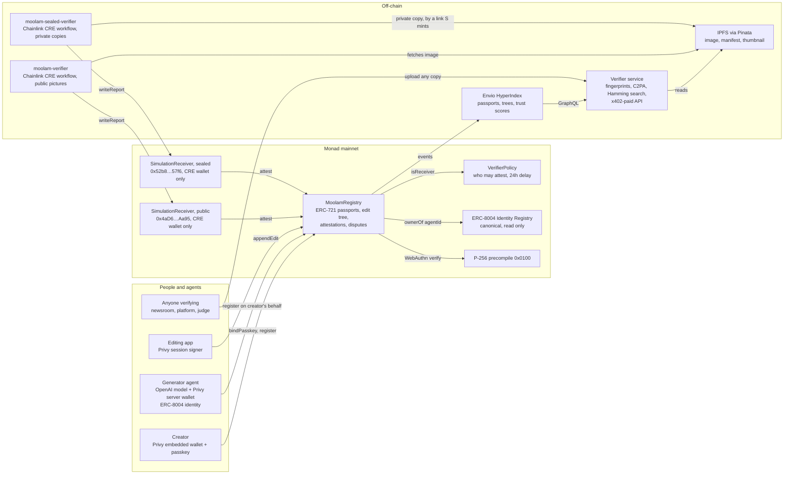
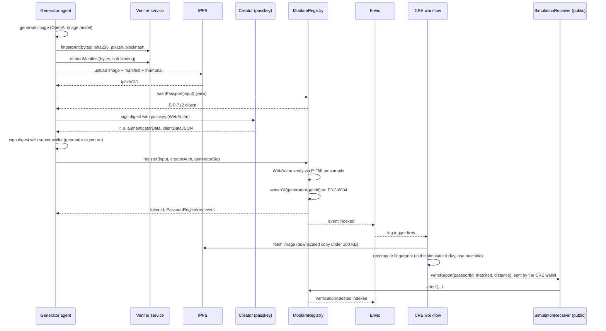
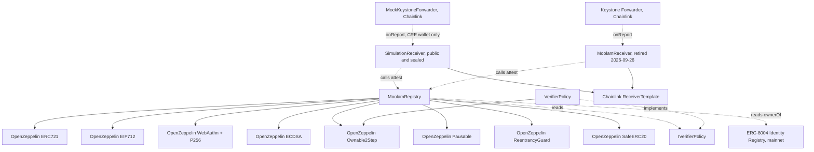

# Moolam architecture

Moolam gives every AI-generated image a passport on Monad: a permanent record of
the exact bytes, two perceptual fingerprints that survive re-encoding, the C2PA
manifest, the creator and the generator agent. Anyone can verify any copy, even
one a platform has stripped of metadata. This file holds the three diagrams and
the exact interface the app and the indexer are written against.

## 1. System overview

## 2. Main sequence: a generated image gets a passport and is verified

Today the workflow runs in Chainlink's simulator and its report reaches the receiver through
Chainlink's MockKeystoneForwarder, so the receiver takes it only from a transaction the CRE wallet
signed. A private re-check runs the same way through `moolam-sealed-verifier` and the sealed
`SimulationReceiver`.

Verification of a copy later: anyone uploads a file to the service, the service
computes the eight rotated and mirrored fingerprints, searches the index, returns
the best passport with its attestations, its edit chain and a confidence score.

## 3. Contract dependency graph

## 4. What is immutable and what can change

- MoolamRegistry has no upgrade path. Records, edits and attestations are only
  ever added. The owner can pause new writes and rescue tokens sent by mistake;
  the owner cannot edit or delete a passport.
- VerifierPolicy is the only mutable piece: the list of receivers allowed to
  attest, the dispute resolver, the treasury and the bond. Every change is
  queued and executes 24 hours later, publicly, except removing a receiver,
  which is immediate so a compromised verifier can be cut off.
- The ERC-8004 registry is Monad's canonical deployment; Moolam only reads it.

## 5. The interface the app and the indexer use

Live on Monad mainnet (chain 143), deployed in block 103054771 and verified on MonadVision. The two
simulation receivers were deployed in blocks 108102667 and 108102676 and have been the receivers
the policy lists since 2026-09-27 14:18 UTC:

| Contract | Address |
|---|---|
| MoolamRegistry | 0xa19188801E5DC93CD925884d73e4DaFc2bcb80C0 |
| VerifierPolicy | 0x54e8Ed8c2c3Cf2A36F8B3AC4c7f02acFD2455821 |
| SimulationReceiver, public, `moolam-verifier` sends here, listed in tx 0xac642cc5c89290a2659e0ee7aaa78d7b729643f22138725815590dd2abbc0bfb | 0x4aD66c77f961884E9e866EEEc3EafF1EdB5BAa95 |
| SimulationReceiver, sealed, `moolam-sealed-verifier` sends here, listed in tx 0x0e1e2937ee4593cb8aad78d4bb6696b14584080b216d4c3c028f0c32eecf457d | 0x52b8fE549B432920eeB061c26cAc5c2D527657f6 |
| MoolamReceiver, public (retired 2026-09-26), history kept | 0x0d69055c43EAcb3B1ca687ca2263A049Bc7Eff04 |
| MoolamReceiver, sealed (retired 2026-09-26), history kept | 0x7b9eF7cD5e40Af9c29d8b7d0D22E54B80947E45A |
| ERC-8004 Identity Registry (Monad's) | 0x8004A169FB4a3325136EB29fA0ceB6D2e539a432 |
| Chainlink MockKeystoneForwarder, which the simulation receivers listen to | 0x9eF6468C5f37b976E57d52054c693269479A784d |
| Chainlink Keystone Forwarder (production) | 0x76c9cf548b4179F8901cda1f8623568b58215E62 |

The simulation receivers' deploy record is
`packages/contracts/deployments/simulation-receivers-monad-mainnet.json`.

The first mainnet deployment (registry 0xeBeeD7A422531789aa009a9c45CC10C84dF12119, block
102977372) is superseded by the addresses above.

The demo generator is agent 10248 on the identity registry. ABIs live in `packages/contracts/abi/`.

Writes:
- `bindPasskey(qx, qy, auth)` from the creator's wallet, once per key.
- `register(input, creatorAuth, generatorSig)` from anyone; authority comes
  from the two signatures.
- `appendEdit(input, generatorSig)` from the parent's owner or an approved
  operator, which is how a Privy session signer acts.
- `flag(passportId, evidenceURI)` with the bond as value; `withdraw()`.

Reads:
- `hashPassport(input)` and `hashBind(wallet, qx, qy, nonce)` give the exact
  digests to sign.
- `getPassport(id)`, `passportExists(id)`, `ownerOf(tokenId)`, `tokenURI`.
- `getAttestations(id, offset, limit)`, `attestationCount(id)`.
- `getChildren(id, offset, limit)`, `childCount(id)`.
- `getDispute(id)`, `withdrawable(who)`, `getPasskey(wallet)`, `bindNonce`.

Events the indexer consumes: PasskeyBound, PassportRegistered,
VerificationAttested, PassportFlagged, DisputeResolved, Withdrawn, Rescued, and
the ERC-721 Transfer.
