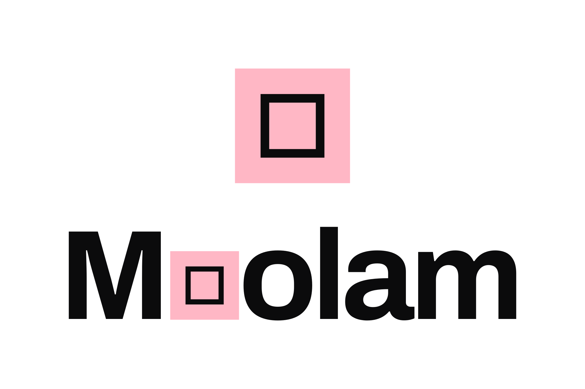
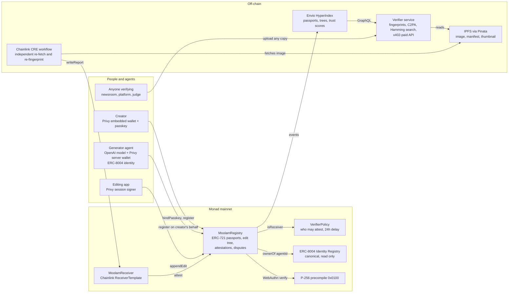
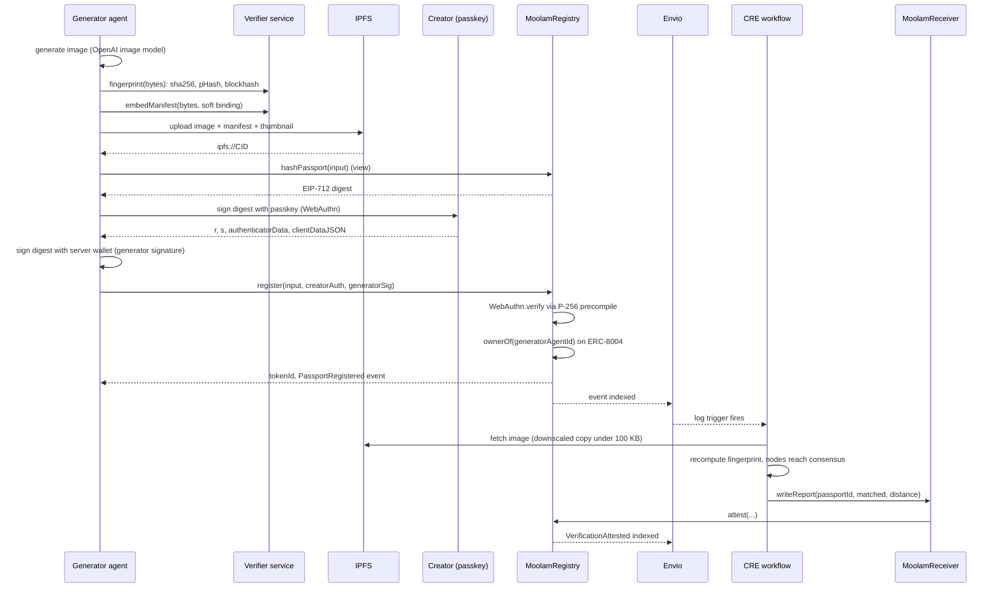
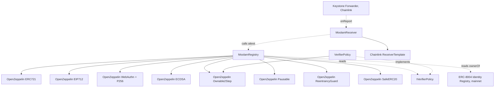

<p align="center">
  <picture>
    <source media="(prefers-color-scheme: dark)" srcset="packages/web/public/brand/seal-o/lockup-stacked-dark.svg">
    
  </picture>
</p>

<p align="center">
  <strong>Every image gets a passport on Monad that survives re-encoding, and anyone can verify any copy.</strong><br>
  <em>Moolam is Tamil for source or origin, which is what the product records: where a picture came from.</em>
</p>

<p align="center">
  Live App: coming with the Vercel deploy &nbsp;|&nbsp;
  Documentation: coming with the Vercel deploy, and <a href="docs/docs/intro.md">docs/docs/intro.md</a> reads on GitHub today &nbsp;|&nbsp;
  <a href="https://monadvision.com/address/0xa19188801E5DC93CD925884d73e4DaFc2bcb80C0">Contracts on MonadVision</a>
</p>

---

## Live on Monad mainnet

Chain 143, all three deployed in block 103054771 and verified on MonadVision through Sourcify.

| Contract | Address | Deploy block | Verified |
| --- | --- | --- | --- |
| MoolamRegistry | [`0xa19188801E5DC93CD925884d73e4DaFc2bcb80C0`](https://monadvision.com/address/0xa19188801E5DC93CD925884d73e4DaFc2bcb80C0) | 103054771 | Sourcify match |
| VerifierPolicy | [`0x54e8Ed8c2c3Cf2A36F8B3AC4c7f02acFD2455821`](https://monadvision.com/address/0x54e8Ed8c2c3Cf2A36F8B3AC4c7f02acFD2455821) | 103054771 | Sourcify match |
| MoolamReceiver | [`0x0d69055c43EAcb3B1ca687ca2263A049Bc7Eff04`](https://monadvision.com/address/0x0d69055c43EAcb3B1ca687ca2263A049Bc7Eff04) | 103054771 | Sourcify match |

Two contracts Moolam reads and did not deploy: Monad's canonical
[ERC-8004 Identity Registry](https://monadvision.com/address/0x8004A169FB4a3325136EB29fA0ceB6D2e539a432)
at `0x8004A169FB4a3325136EB29fA0ceB6D2e539a432`, and Chainlink's production
[Keystone Forwarder](https://monadvision.com/address/0x76c9cf548b4179F8901cda1f8623568b58215E62)
at `0x76c9cf548b4179F8901cda1f8623568b58215E62`.

---

## Overview

A picture on the internet carries no proof of where it came from. The metadata that was supposed to
carry it is the first thing a platform throws away, so by the time anyone asks who made this, the
answer has already been recompressed out of the file.

Moolam writes the answer somewhere the platform cannot reach. Every image gets a passport on Monad:
the exact sha256 of the bytes, two perceptual fingerprints that describe the picture rather than the
bits, the C2PA manifest hash, the creator and the generator agent. Two signatures have to check out
on chain before that record exists. The creator signs with the passkey on their own phone or laptop,
verified through Monad's P-256 precompile at `0x0100`. The AI agent that generated the image signs
the same digest with the wallet that owns its ERC-8004 identity. Neither signature is checked on a
server, and neither can be added later.

Verification then runs on the picture, not on the file. Upload any copy to the verify service and it
computes the same fingerprints, tries all eight rotated and mirrored versions, and searches the
registered passports. On the prove-it run against Monad mainnet, six mangled copies of one image and
one copy with every scrap of metadata removed all resolved back to the same passport.

| | C2PA metadata alone | Platform watermarks | Nothing | Moolam |
| --- | --- | --- | --- | --- |
| Survives re-encoding | No. The hard binding is a hash of the exact bytes and breaks on the first recompression | Not measured here | No | Yes. 6 of 6 mangled copies matched on mainnet, including quality 60, a quarter resize and two rounds of social resizing |
| Survives metadata stripping | No. Strip the manifest and nothing is left | Not measured here | No | Yes. The stripped copy came back at 0.99 confidence with the manifest confirmed gone |
| Who can verify | Anyone with a C2PA reader, while the manifest is still attached | The platform that embedded it | Nobody | Anyone. Post the file to the open verify service, or read the registry yourself |
| Who vouches | Whoever holds the signing certificate | The platform | Nobody | The creator's passkey and the generator agent's ERC-8004 owner, then a Chainlink CRE quorum on top |
| Cost per image | Free | Free | Free | 376,104 gas on the live mainnet run, about 0.0376 MON at Monad's 100 gwei minimum base fee |

---

## Features

### For creators

- Sign in with Privy and get an embedded wallet with no seed phrase to write down.
- Bind a passkey once with `bindPasskey`, then every registration is a real WebAuthn assertion from
  your own device. Both user presence and user verification are required, so a passport can only be
  created by someone who touched the sensor and passed its biometric or PIN.
- Anyone may send the `register` transaction. Authority comes from the two signatures rather than
  from `msg.sender`, which is what lets a relayer pay a creator's gas. Privy gas sponsorship is a
  dashboard setting for this app, and on the recorded run it was on: the creator's bind went out as
  a sponsored EIP-7702 user operation, landed in block 103263011 from Privy's bundler through the
  ERC-4337 entry point, the script printed `sponsorship: on, the app paid the gas, not the creator's
  wallet`, and the creator paid nothing.

### For AI agents

- An agent's identity is an ERC-8004 token on Monad's canonical registry, not a Moolam record.
  Moolam reads `ownerOf(agentId)` and nothing else, so an agent's history is portable and Moolam can
  never mint, revoke or edit an identity.
- The agent's key lives in Privy's enclave under a policy that allows exactly two things: `register`
  on the Moolam registry on chain 143 carrying no MON, and EIP-712 signing whose domain is that same
  registry. A hijacked prompt cannot move MON, call another contract or write an edit.
- A creator can grant an editing app a session signer scoped to `appendEdit` alone, which is how one
  session writes ten edits without ten passkey prompts. Revoke it and Privy refuses the same call
  before it can reach Monad.

### For anyone verifying

- Post any copy of an image to `POST /verify`. The service fingerprints it three ways (the exact
  sha256, a 64-bit pHash, a 256-bit blockhash), builds all eight rotated and mirrored variants,
  searches by Hamming distance, and reads any C2PA manifest still attached.
- A match has to clear both thresholds: pHash at most 10 of 64 and blockhash at most 40 of 256. Past
  either one nothing is returned and confidence is 0. An exact sha256 hit scores 1.
- The fingerprint is written into the C2PA manifest as a soft binding under the algorithm name
  `com.moolam.phash-blockhash.v1`, which is the part that survives a re-upload. Strip the manifest
  and the fingerprint still matches against the on-chain registry.

### For the record

- Chainlink CRE is the second opinion. A log trigger on `PassportRegistered` wakes a workflow, each
  node downloads the thumbnail and recomputes the 64-bit hash inside the sandbox, and a quorum has
  to produce the identical verdict before it is signed into a report and written back through
  `MoolamReceiver` as an attestation.
- Envio HyperIndex turns the events into rows: passports, edit trees, verification tallies,
  disputes, and a per-generator trust score of
  `round(100 * (matched + 1) / (matched + mismatched + 2 * disputesUpheld + 2))`, so a new agent
  starts at a neutral 50 rather than a meaningless 100.
- Anyone who disagrees with a record can post a bond and call `flag`. The resolver named by
  `VerifierPolicy` settles it. Money is pulled, never pushed, and the owner can never sweep an open
  bond or an unclaimed credit.

---

## Mainnet deployment

The three contracts went live on Monad mainnet on 2026-09-08 in block 103054771, in one scripted
deploy of seven transactions that also pins the receiver to the workflow author and name and closes
the policy bootstrap window. `packages/contracts/deployments/monad-mainnet.json` records every
address and transaction hash and is the source of truth for every script.

This is the second deployment. The first (registry `0xeBeeD7A422531789aa009a9c45CC10C84dF12119`,
block 102977372) is superseded: the code review produced ten confirmed findings, the fixes changed
the registry, and an immutable contract cannot be patched in place. All three contracts were
redeployed, verified again through Sourcify, and every proof in this repo was re-run against the new
addresses.

The demo generator is agent **10248** on the ERC-8004 Identity Registry, owned by the deployer
`0x559F357aDa3A96d11AEa679eC0D622E4AF15F67c`. A live Chainlink CRE broadcast on 2026-09-08
recomputed `0x233ccc7872442123` at distance 0 and wrote its report in transaction
[`0x3a814ab2...88796a0`](https://monadvision.com/tx/0x3a814ab20ac8c2e1c8d46c944c612722c6878a80cd823235afd2434de88796a0),
which left that passport with an `attestationCount` of 1, `matched` true and distance 0.

---

## Architecture

The three diagrams below are the ones in [ARCHITECTURE.md](ARCHITECTURE.md), which also holds the
exact interface the app and the indexer are written against.

### System overview

People and agents write to three contracts on Monad. Everything expensive stays off chain: the
fingerprinting, the C2PA work and the Hamming search live in the verify service, IPFS holds the
files, Envio holds the queryable copy of the chain, and the Chainlink workflow is the only piece
that reads off chain and writes back on chain.



### One image, from generation to attestation

The order matters. Everything is pinned to IPFS before any transaction is sent, so a failed upload
costs no gas. `hashPassport` returns the EIP-712 digest, and that same digest is the WebAuthn
challenge, so the creator's device and the agent's enclave sign one value rather than two. Only
after both signatures verify on chain is the record written and the token minted.



### Contract dependencies

The registry leans on audited OpenZeppelin primitives and reads two contracts it does not own. The
Chainlink `ReceiverTemplate` is vendored word for word so it can be diffed against Chainlink's
published source. `VerifierPolicy` is the only mutable piece, and the registry has no upgrade path
at all.



---

## The two-minute judge path

### One command, against Monad mainnet

```sh
npm run prove
```

It takes about two minutes and about 0.4 MON. It draws a picture nobody has registered, signs a C2PA
manifest into it, pins four files to IPFS, registers the passport on mainnet, puts the image through
six real journeys, strips every scrap of metadata, answers a forgery, and executes all twelve attacks
in the threat model. Every section prints a transaction hash or the exact refusal, and one line
saying what it does not prove. The last lines of the recorded run, saved in
[proofs/prove-it.txt](proofs/prove-it.txt):

```
6. Summary
==========
  section      result  evidence
  -----------  ------  ---------------------------------------------------------------------------------------------
  1. Register  PASS    https://monadvision.com/tx/0xa791425b6a048864fe5fd803c70377e24c52c93b953ef3aaa18b2b9f3b321c9b
  2. Survive   PASS    6 of 6 copies matched
  3. Strip     PASS    manifest gone, confidence 0.99
  4. Forge     PASS    PassportAlreadyExists, oldest passport is the first one
  5. Attacks   PASS    12 of 12 refused

PASS: the Moolam prove-it run, end to end, against Monad mainnet.
finished 2026-09-08T14:10:42.572Z, 128 seconds
```

### The click path

Open the live app (the link row above carries the URL once the Vercel deploy is up; on this machine it is http://localhost:3210). Two minutes, no wallet, no seed phrase:

1. Scroll the home page. Every floating plate is a real passport read from the registry; the captions quote the live block, the Chainlink attestation and the agent score. Near the end, the panel that says "Drop any copy of any image here, or choose a file" takes any image: drop a screenshot of one of the plates and the verify service answers in place with the match and its confidence.
2. Open "Verify an image" in the header, press "Choose an image", pick any copy of a registered image (a re-encoded, resized or mirrored copy works), then press "Verify". The card turns over with the matched passport, the confidence, the two fingerprint distances and whether a C2PA manifest is still attached. An unregistered picture answers plainly that it is not registered and offers the studio.
3. Open "Register an image". Press "Sign in and create my account" and sign in with an email code. Privy creates the account on Monad in the background. The identity strip shows the account address, the network and "Network fee: paid by Moolam through Privy".
4. Press "Use this device's unlock". The device's fingerprint, face or PIN prompt appears twice (once to make the key, once to sign) and one sponsored transaction binds it to the account. The card reads "Bound" with a MonadVision link.
5. Press "Choose a file", pick a JPEG, give it a title and press "Register this image". Three honest steps run: pinning to IPFS (about ten seconds), the device prompt, then sending. The receipt shows the passport id, the block and links to the passport page, MonadVision and the pinned image. Register the same file again and the screen says it is already registered and links to the passport that holds it.
6. Open the passport page from the receipt: the poster, the facts, the attestations (a Chainlink line when the CRE workflow has re-checked it), the lineage and a "check a copy" drop that answers yes or no against this passport alone. From there, the agent page shows any generator agent's ERC-8004 identity, its reputation and its works.

---

## Quick Start

### Prerequisites

- Node 22.13 or newer, per the root `package.json` engines field. The verify service container is
  built on `node:26-bookworm-slim`.
- Foundry, for anything that touches the contracts.
- WSL2 with Linux Node for the indexer only. `envio codegen` and the indexer tests are Linux builds.

### Install

```sh
git clone https://github.com/ramakrishnanhulk20/Moolam.git
cd Moolam
npm install
cp .env.example .env
```

The contracts need the OpenZeppelin submodule and a build:

```sh
git submodule update --init --recursive
cd packages/contracts && forge build
```

### The environment file

Every variable is in [.env.example](.env.example) with a comment saying where its value comes from.
No key, seed phrase or token is hardcoded anywhere in the repo. The table below says what each one
is for and which piece stops without it.

| Variable | Where the value comes from |
| --- | --- |
| `MONAD_MAINNET_RPC_URL` | Monad's public endpoint `https://rpc.monad.xyz`, or your own provider |
| `DEPLOYER_PRIVATE_KEY`, `DEPLOYER_ADDRESS` | The wallet that deploys and runs the seed and proof scripts. Monad reserves 10 MON per account on top of gas |
| `PROOF_P256_PRIVATE_KEY` | The proof script's stand-in passkey. It generates one on first run |
| `CRE_ETH_PRIVATE_KEY`, `CRE_WALLET_ADDRESS`, `CRE_API_KEY` | The Chainlink CRE wallet that signs attestation transactions, and the CRE dashboard key or `cre login` |
| `CRE_WORKFLOW_NAME` | The workflow name in `packages/workflow/moolam-verifier/workflow.yaml`. The receiver is pinned to it, so the two must match |
| `PRIVY_APP_ID`, `PRIVY_APP_SECRET`, `PRIVY_AUTHORIZATION_KEY` | dashboard.privy.io. The authorization key is what controls server wallets from the backend |
| `ENVIO_API_TOKEN`, `ENVIO_GRAPHQL_URL` | envio.dev/app/api-tokens, and the GraphQL endpoint of the Cloud deployment |
| `OPENAI_API_KEY`, `OPENROUTER_API_KEY` | The generator agent's brain and image model. OpenRouter is the text fallback |
| `PINATA_JWT`, `PINATA_GATEWAY_URL` | app.pinata.cloud. The JWT pins images and manifests, so treat it as a spending secret |
| `ALCHEMY_API_KEY`, `ALCHEMY_WEBHOOK_SIGNING_KEY` | dashboard.alchemy.com, a Monad app key |
| `VERIFIER_PRIVATE_KEY`, `VERIFIER_ADDRESS` | The wallet that posts ERC-8004 reputation feedback. It must not own an agent, because the registry refuses self-feedback |
| `VERIFIER_PORT`, `VERIFIER_BASE_URL`, `CORS_ORIGINS` | Where the verify service listens, its public URL, and the exact browser origins allowed to call it |
| `PASSPORT_SOURCE`, `PASSPORT_SOURCE_PATH` | `envio` reads the live index, `json` reads a local file |
| `X402_ENABLED`, `X402_PRICE`, `X402_PAY_TO_ADDRESS`, `X402_FACILITATOR_URL` | The optional paid verify route and who collects the fee |
| `MOOLAM_C2PA_CERT_PATH`, `MOOLAM_C2PA_KEY_PATH` | A real C2PA signing certificate and its key. Set both or neither; the package generates a throwaway chain on first run |
| `MONADSCAN_API_KEY` | Optional. Sourcify verification through MonadVision needs no key |

### Run it

```sh
npm run dev:verifier    # the verify service, on VERIFIER_PORT, which .env.example sets to 4010
npm run dev:web         # the app
```

The app is served on port 3210 here, which is why `.env.example` lists `http://localhost:3210` under
`CORS_ORIGINS`. That entry has to be the exact origin the browser loads the app from, with no
wildcard and no trailing slash, or the studio upload fails in the browser with a CORS error while
curl against the same URL works.

### The tests

| Package | Command | Tests |
| --- | --- | --- |
| Contracts | `npm test` from `packages/contracts` | 119 |
| Verify service | `npm run test:verifier` | 98 |
| Chain client and agents | `npm run test:agents` | 30 |
| Indexer | `npm run test:indexer` | 9 |
| Web app | `npm test` from `packages/web` | 137 |

Foundry needs `-n monad` on anything that touches Monad, which the package scripts already carry.
Without it `vm.createSelectFork` refuses, and the local EVM prices gas as Ethereum rather than as
the chain this ships on.

The indexer is the one exception to running anything on Windows. `envio codegen` and the test
indexer are Linux builds, so both run inside WSL2 with its own Linux `node_modules` installed with
`npm install --no-workspaces` under `packages/indexer`:

```sh
wsl -e bash -lc 'export NVM_DIR="$HOME/.nvm"; . "$NVM_DIR/nvm.sh"; cd /mnt/d/Projects/Monad && npm run test:indexer'
```

On Linux or macOS the plain `npm run` commands are all you need.

---

## Integration

### Verify a copy against the service

```sh
curl -s -F "file=@some-copy.jpg" http://localhost:4010/verify
```

The answer below is the real one for the quality-60 re-encode in section 2 of the prove-it run.

```jsonc
{
  "result": {
    "exact": null,                 // the passport id when the bytes are byte for byte a registered file
    "best": {
      "id": "0x0e940dfadb10c49bf1a2578cc12167242a9e2aec06500337f4889556379cda80",
      "phashDistance": 0,          // 0 to 64, and a match is at most 10
      "blockhashDistance": 0,      // 0 to 256, and a match is at most 40
      "variant": "identity",       // which of the eight orientations found it
      "score": 0.99
    },
    "matches": [ /* every match, best first, at most 20 */ ],
    "confidence": 0.99,            // 1 for an exact byte hit, 0 when nothing matched
    "queried": {
      "sha256": "0x...",
      "phash": "2072653346334783171",   // decimal, never a JSON number: a double cannot hold 64 bits
      "blockhash": "0x007f00ff00ff01ff001cc7ccc7e6e7c6c7c6c7e607e607c0007f00ff00ff01ff",
      "width": 1024, "height": 768, "format": "jpeg"
    }
  },
  "manifest": {
    "present": true,
    "softBinding": { "alg": "com.moolam.phash-blockhash.v1", "phash": "2072653346334783171", "blockhash": "0x007f..." }
  }
}
```

Past either threshold nothing is returned and confidence is 0, so a near miss never reads as a
match.

### Read a passport with viem

The three ABIs live in [`packages/contracts/abi`](packages/contracts/abi).

```ts
import { createPublicClient, http } from "viem";
import abi from "./packages/contracts/abi/MoolamRegistry.json";

const client = createPublicClient({ transport: http("https://rpc.monad.xyz") });

const passport = await client.readContract({
  address: "0xa19188801E5DC93CD925884d73e4DaFc2bcb80C0",
  abi,
  functionName: "getPassport",
  args: ["0x0e940dfadb10c49bf1a2578cc12167242a9e2aec06500337f4889556379cda80"],
});

console.log(passport.creator, passport.generatorAgentId, passport.registeredAt);
```

The indexer serves the same data over GraphQL at
`https://indexer.dev.hyperindex.xyz/2bfc8fe/v1/graphql`. Addresses are stored lowercase there,
including entity ids, so query with lowercase addresses.

---

## The contracts

### MoolamRegistry

ERC-721 `Moolam Content Passport` (`MOOLAM`), EIP-712 domain name `Moolam`, version `1`. The token
id of a passport is `uint256(passportId)`, and `passportId` is the sha256 of the exact image bytes.
Full reference in [docs/docs/api/registry.md](docs/docs/api/registry.md).

| Function | Who may call | What it does | Notable reverts |
| --- | --- | --- | --- |
| `bindPasskey(qx, qy, auth)` | Any wallet, for itself | Attaches or rotates a P-256 key. The wallet proves it holds the key by signing the bind digest, and each bind consumes a nonce | `InvalidPublicKey`, `InvalidPasskeySignature` |
| `register(p, creatorAuth, generatorSig)` | Anyone. Authority is the two signatures | Writes an original passport and mints the token to `p.creator` | `PassportAlreadyExists`, `PasskeyNotBound`, `InvalidPasskeySignature`, `UnknownAgent`, `InvalidGeneratorSignature`, `SignatureExpired` |
| `appendEdit(p, generatorSig)` | The current owner of the parent token | Records an edit and mints the child. ERC-721 approvals and operators are refused | `ParentNotFound`, `NotParentOwner`, `InvalidKind`, `InvalidGeneratorSignature` |
| `attest(id, matched, distance, recomputed)` | An address `VerifierPolicy.isReceiver` allows | Writes one verifier's recheck. Stays open while paused so a verification in flight can land | `NotReceiver`, `PassportNotFound`, `AttestationCapReached` |
| `flag(id, evidenceURI)` | Anyone, with exactly the bond as value | Opens a dispute. Only the keccak256 of the URI is stored, so the evidence cannot be swapped | `DisputeAlreadyOpen`, `PassportAlreadyDisputed`, `InvalidBond` |
| `resolve(id, upheld)` | `VerifierPolicy.resolver()` | Settles a dispute. Upheld credits the challenger, rejected credits the treasury | `NotResolver`, `NoOpenDispute` |
| `withdraw()` / `withdrawTo(to)` | Whoever is owed | Pulls the caller's own credit. Works while paused, so a pause cannot trap money | `NothingToWithdraw`, `TransferFailed`, `ZeroAddress` |
| `pause()` / `unpause()` / `rescueERC20` / `rescueNative` | Owner | Stops new writes, or moves value sent by mistake. `rescueNative` excludes `totalBonds` and `totalOwed` | `ZeroAddress`, `NothingToRescue` |

Reads: `hashPassport`, `hashBind`, `bindNonce`, `getPassport`, `passportExists`, `getPasskey`,
`attestationCount`, `getAttestations`, `childCount`, `getChildren`, `getDispute`, `withdrawable`,
`totalBonds`, `totalOwed`, `policy`, `agentIdentity`, `MAX_ATTESTATIONS` (64), `tokenURI`, plus
OpenZeppelin's unmodified ERC-721 surface.

### VerifierPolicy

| Function | Who may call | What it does | Notable reverts |
| --- | --- | --- | --- |
| `isReceiver(who)` | Anyone | True when that address may call `attest` | none |
| `resolver()`, `treasury()`, `disputeBond()`, `bootstrapped()`, `getPendingChange(id)` | Anyone | The current settings and any queued change | none |
| `bootstrapAddReceiver(who)` | Owner, during setup only | Lists a receiver at once. The deploy script uses it, then closes the window | `BootstrapClosed`, `AlreadyReceiver` |
| `finalizeBootstrap()` | Owner | Closes the setup window for good. It can never reopen | `BootstrapClosed` |
| `removeReceiver(who)` | Owner | Immediate. A compromised verifier has to stop writing in the same block | `NotAReceiver` |
| `queueAddReceiver` / `queueSetResolver` / `queueSetTreasury` / `queueSetDisputeBond` | Owner | Queues a change that widens trust. It executes 24 hours later, in the open | `ChangeAlreadyQueued`, `TreasuryCannotReceive`, `ZeroAddress` |
| `execute(id)` / `cancel(id)` | Owner | Applies or drops a queued change | `UnknownChange`, `ChangeNotReady` |

### MoolamReceiver

| Function | Who may call | What it does | Notable reverts |
| --- | --- | --- | --- |
| `onReport(metadata, report)` | The configured Chainlink KeystoneForwarder | Checks the sender, the pinned workflow author and name, the chain id and a per-passport monotonic timestamp, then calls `attest` | `InvalidSender`, `InvalidAuthor`, `InvalidWorkflowName`, `InvalidWorkflowId`, `WrongChain`, `StaleReport` |
| `lastExecutedAt(passportId)`, `REGISTRY()`, `getForwarderAddress()`, `getExpectedAuthor()`, `getExpectedWorkflowName()`, `getExpectedWorkflowId()` | Anyone | What the receiver is pinned to, and the newest report accepted per passport | none |
| `setForwarderAddress` / `setExpectedAuthor` / `setExpectedWorkflowName` / `setExpectedWorkflowId` | Owner | Chainlink's template setters. Each emits an event | `InvalidForwarderAddress`, `WorkflowNameRequiresAuthorValidation` |

### The verify service

Four routes, all JSON including errors. Full reference in
[docs/docs/api/verifier-endpoints.md](docs/docs/api/verifier-endpoints.md).

| Route | What it takes | What it answers | Mounted when |
| --- | --- | --- | --- |
| `POST /verify` | A multipart `file`, or `{ "url": "https://..." }`. 20 MB and 40 megapixels | `{ result, manifest }`. 400, 403 on a private or loopback address, 413, 429 past 60 a minute, 502 | always |
| `POST /verify/paid` | A multipart `file` only | The same body behind an x402 payment, 5 cents in USDC on Monad by default. 402 carries the terms | `X402_ENABLED=true`, else 404 |
| `POST /prepare` | A multipart `file`, `title` and `kind`, with a Privy access token in `Authorization: Bearer` | The passport fields plus the four pinned content ids. 401, 415, 429 past 20 an hour per creator, 502 `pin-failed` | `PINATA_JWT` and `PRIVY_APP_ID` are set, else 404 |
| `GET /health` | nothing | `{ ok, records, version }`, where `records` is how many passports the index holds | always |

Browsers reach any of it only from an exact origin listed in `CORS_ORIGINS`. No wildcard, no path,
no trailing slash.

---

## Test output

| Suite | Tests | What it covers |
| --- | --- | --- |
| Contracts | 119 | 18 on the policy timelock, 75 on the registry covering every rule, custom error and event, 15 on the Chainlink receiver path, 5 fuzz tests, an invariant suite that drove 8,192 random calls through six actors, and 5 fork tests against real Monad mainnet state |
| Verify service | 98 | Fingerprints, the eight orientations, C2PA soft bindings, the fetch guard, the prepare route and its token checks |
| Chain client and agents | 30 | The EIP-712 digests checked against the contract's own `hashPassport` and `hashBind`, the whole write path on a fork of mainnet, six refusals decoded to their error names, and the sponsored-send handling (hash polling, refusal classification, the nonce guard) |
| Indexer | 9 | The handlers against the generated Envio types with the live mainnet addresses |
| Web app | 137 | The passkey, CBOR, DER and calldata libraries, the verifier client, the studio flow and its confirm-by-state, the verify answer and the trust pages |

The six invariants all held: the contract balance always covers every liability, the bond total
always equals the sum of open disputes, every edit points at a parent that exists, no image id is
ever minted twice, attestations only ever come from an address the policy lists, and no passport
appears while the registry is paused. Each test file opens with a note saying what it does not
cover.

Every attack in the [threat model](docs/docs/security/threat-model.md) was executed against the live
contracts, and each one saved its full output under
[docs/docs/security/attacks/](docs/docs/security/attacks/):

```
6. Summary
==========
  section      result  evidence
  -----------  ------  ---------------------------------------------------------------------------------------------
  1. Register  PASS    https://monadvision.com/tx/0x599b33957f4efced343ee93c88acd48e6339b1afed08078d3bedd61a078e5834
  2. Survive   PASS    6 of 6 copies matched
  3. Strip     PASS    manifest gone, confidence 0.99
  4. Forge     PASS    PassportAlreadyExists, oldest passport is the first one
  5. Attacks   PASS    12 of 12 refused

  attack                           result   saved output
  -------------------------------  -------  --------------------------------------------------------------
  passkey-replay                   REFUSED  docs/docs/security/attacks/passkey-replay.txt
  generator-signature-forged       REFUSED  docs/docs/security/attacks/generator-signature-forged.txt
  unknown-agent                    REFUSED  docs/docs/security/attacks/unknown-agent.txt
  expired-deadline                 REFUSED  docs/docs/security/attacks/expired-deadline.txt
  edit-by-non-owner                REFUSED  docs/docs/security/attacks/edit-by-non-owner.txt
  attest-from-stranger             REFUSED  docs/docs/security/attacks/attest-from-stranger.txt
  report-from-fake-forwarder       REFUSED  docs/docs/security/attacks/report-from-fake-forwarder.txt
  receiver-replay-and-wrong-chain  REFUSED  docs/docs/security/attacks/receiver-replay-and-wrong-chain.txt
  privy-policy-refusal             REFUSED  docs/docs/security/attacks/privy-policy-refusal.txt
  revoked-session-signer           REFUSED  docs/docs/security/attacks/revoked-session-signer.txt
  dispute-money-rules              REFUSED  docs/docs/security/attacks/dispute-money-rules.txt
  verifier-api-limits              REFUSED  docs/docs/security/attacks/verifier-api-limits.txt

PASS: the Moolam prove-it run, end to end, against Monad mainnet.
finished 2026-09-09T09:19:22.530Z, 123 seconds
```

The six copies in section 2 of the same run, every one resolving to the same passport:

```
  copy            bytes  matched as  phash    blockhash  confidence  resolves to the passport
  ------------  -------  ----------  -------  ---------  ----------  ------------------------
  reencode-q60   52,453  identity    0 of 64  0 of 256         0.99  yes
  resize-25       8,806  identity    1 of 64  0 of 256         0.94  yes
  rotate-90     221,822  rot90       0 of 64  0 of 256         0.99  yes
  mirror        228,608  mirror      0 of 64  0 of 256         0.99  yes
  screenshot     65,902  identity    1 of 64  0 of 256         0.94  yes
  social-chain   35,238  identity    6 of 64  0 of 256         0.67  yes
```

---

## What it costs

Monad bills the gas limit a transaction declares rather than the gas it uses, so every script here
declares its limit with `--gas-estimate-multiplier 110` instead of Foundry's default 130, which
would overpay by a fifth. Median gas from the report in [proofs/gas.txt](proofs/gas.txt), measured
in Foundry's Monad network family so the pricing matches the chain this ships on:

| Action | Median gas | At 100 gwei |
| --- | --- | --- |
| `bindPasskey`, once per wallet | 117,165 | 0.0117 MON |
| `register`, the main one | 254,429 | 0.0254 MON |
| `appendEdit` | 299,849 | 0.0300 MON |
| `attest`, what a verification result costs | 126,113 | 0.0126 MON |
| `flag`, opening a dispute with its bond | 172,939 | 0.0173 MON |
| `withdraw` | 40,717 | 0.0041 MON |

The real mainnet register in the prove-it run came in higher, at **376,104 gas, about 0.0376 MON**,
because that passport carries a longer metadata URI and the first touch of the ERC-8004 registry in
a block pays the cold account cost. That is the number to quote for one image in production.

The whole receiver path, a Chainlink report arriving and landing as an attestation, measured
266,711 gas in the contract tests, about 0.0267 MON, of which `attest` itself is at most 154,285.
Deploying all three contracts, pinning the receiver, registering the demo agent and running the live
proof came to 9,609,437 gas in total, which is 0.961 MON. A deployer wallet needs roughly 1 MON of
headroom on top of Monad's 10 MON reserve balance, which every account has to keep and cannot spend.

---

## Project structure

```
Moolam/
├── packages/
│   ├── contracts/          Solidity, Foundry. The three contracts, 119 tests, deploy and proof scripts
│   │   ├── src/            MoolamRegistry, VerifierPolicy, MoolamReceiver, the vendored Chainlink template
│   │   ├── test/           unit, fuzz, invariant and mainnet fork suites
│   │   ├── script/         Deploy, ConfigureReceiver, RegisterAgent, LiveProof
│   │   ├── abi/            the three ABIs the app and the indexer read
│   │   └── deployments/    monad-mainnet.json, the source of truth for every script
│   │
│   ├── verifier/           The verify service: fingerprints, C2PA, the eight orientations, /prepare
│   │   └── src/            fingerprint, dihedral, match, c2pa, prepare, routes, the x402 and auth guards
│   │
│   ├── agents/             The shared TypeScript client, the generator agent, and every proof script
│   │   └── src/            chain (digests, passkey, registry), privy, media, ipfs, seed, prove, agent
│   │
│   ├── indexer/            Envio HyperIndex V3: passports, edit trees, tallies, disputes, trust scores
│   │
│   ├── workflow/           The Chainlink CRE workflow that recomputes the fingerprint independently
│   │
│   └── web/                The Next.js app: passports, agents, verification, the creator studio
│
├── docs/                   The Docusaurus documentation site
├── proofs/                 Every proof output: prove-it, gas, slither, robustness, seeds, transcripts
├── ARCHITECTURE.md         The three diagrams and the exact interface
└── .env.example            Every variable, with a comment on where the value comes from
```

---

## Tech stack

| Layer | Technology | Version |
| --- | --- | --- |
| Chain | Monad mainnet, chain 143, P-256 precompile at `0x0100` | |
| Contracts | Solidity, `evm_version = "osaka"`, optimizer at 200 runs, no via-IR | 0.8.30 |
| Contract libraries | OpenZeppelin Contracts, pinned to the exact tag | 5.6.1 |
| Contract tooling | Foundry, solhint, slither | solhint 6.2.4 |
| Agent identity | ERC-8004 Identity Registry, Monad's canonical deployment | |
| Verification network | Chainlink CRE, `ReceiverTemplate` vendored verbatim | |
| Indexer | Envio HyperIndex | envio 3.9.0 |
| Verify service | Fastify, sharp, sharp-phash, C2PA Node, undici, jose, zod | fastify 5.12.3, sharp 0.35.4, `@contentauth/c2pa-node` 0.9.3 |
| Payments | x402 core and EVM, Monad's facilitator | 2.25.0 |
| Wallets and keys | Privy server wallets, policies, session signers | `@privy-io/node` 0.34.0, `@privy-io/react-auth` 3.40.0 |
| Chain client | viem, wagmi | viem 2.56.3, wagmi 3.7.7 |
| App | Next.js, React, Tailwind, next-intl | Next 16.3.4, React 19.2.8, Tailwind 4.3.3 |
| Motion | GSAP, Lenis, Framer Motion, three.js with React Three Fiber | gsap 3.15.0, lenis 1.3.26, three 0.185.1 |
| Agent brain | OpenAI, with OpenRouter as the text fallback | openai 7.10.0 |
| Storage | IPFS through Pinata | |
| Tests | Vitest, Foundry | vitest 5.0.0 |

---

## Security

The full account is in the [security overview](docs/docs/security/overview.md) and the
[threat model](docs/docs/security/threat-model.md), which lists every claim, the attack against it,
and the file the output is saved in.

### What is in the code

- No upgrade path on the registry. Records, edits and attestations are only ever added. The owner
  can pause new writes and rescue stranded value, and can never edit or delete a passport or touch a
  user balance.
- `Ownable2Step` on both owned contracts. `attest` gated on the policy list, `resolve` on the
  policy's resolver, `appendEdit` on owning the parent token, `onReport` on the Chainlink forwarder
  plus the pinned workflow author and name.
- Four replay guards: the EIP-712 domain carries the chain id and the contract address, `exactHash`
  is the id so a duplicate reverts, `bindPasskey` consumes a nonce per wallet, and every signature
  carries a deadline. The receiver adds two more, `WrongChain` and `StaleReport`.
- Reentrancy guards on every money path, pull payments rather than pushes, `_mint` rather than
  `_safeMint` so no callback ever runs, and no `receive` function at all.
- A 24 hour public delay on every change that widens trust. Removing a receiver is the one immediate
  action.
- Off chain: an SSRF guard that normalises and pins every address it checks, 60 requests a minute
  per socket address, a 20 MB and 40 megapixel cap, a concurrency gate of two matches at a time, and
  Privy access token checks on the one route that spends money.
- Static analysis: slither reports 0 high and 6 medium across 41 contracts and 102 detectors, all
  six checked by hand and recorded as false positives in [proofs/slither.txt](proofs/slither.txt).
  solhint is clean.

### Twelve attacks, executed

`passkey-replay`, `generator-signature-forged`, `unknown-agent`, `expired-deadline`,
`edit-by-non-owner`, `attest-from-stranger`, `report-from-fake-forwarder`,
`receiver-replay-and-wrong-chain`, `privy-policy-refusal`, `revoked-session-signer`,
`dispute-money-rules`, `verifier-api-limits`. Every one was refused, each for the reason the design
gives, and the outputs are saved in the repo.

### What Moolam does not defend against

- **First registered wins.** A passport proves who registered first, not who created. For AI output
  the two are the same moment, because the generator registers before publication. For a human photo
  it is a timestamped claim.
- **Crops.** Cutting 10 percent off each edge moves the pHash about 22 bits of 64 and breaks the
  match. The measured numbers are published in [proofs/robustness.txt](proofs/robustness.txt) rather
  than hidden.
- **Adversarial perturbation.** Someone who knows the algorithms can craft an image that
  fingerprints close to another. The exact hash and the signatures still separate the two records.
- **Software keys.** A key held in page memory while a session is open can be read by a malicious
  dependency in the page. A real passkey never leaves the device, which is why a human creator's key
  must come from the browser's WebAuthn API.
- **IPFS liveness.** If the pinned files disappear, the on-chain record still proves the hashes but
  the image is gone from Moolam's storage. Anyone holding a copy can re-verify it.
- **Self-audited.** No third party has audited these contracts. The attack scripts and their saved
  outputs are the evidence, and they are all in this repo.

---

## License

MIT. See [LICENSE](LICENSE).

---

## Acknowledgments

- [Monad](https://monad.xyz) for the chain and the P-256 precompile at `0x0100`, without which every
  passkey check would happen on a server and the whole claim would collapse into self-reporting.
- [Privy](https://privy.io) for the embedded wallets creators get without a seed phrase, the enclave
  the generator agent's key lives in, the policies that pin it to one function on one contract, and
  the session signers that let an editing session write without ten prompts.
- [Chainlink CRE](https://chain.link) for the independent recheck: nodes that download the image
  themselves, recompute the fingerprint in the sandbox, and have to agree before anything is signed.
- [Envio](https://envio.dev) for HyperIndex, which turns the events into the passports, edit trees,
  tallies and trust scores every screen and the verify service read.
- [OpenZeppelin](https://openzeppelin.com) for the ERC-721, EIP-712, WebAuthn, P256, ECDSA,
  Ownable2Step, Pausable, ReentrancyGuard and SafeERC20 primitives the registry is built on.
- [Pinata](https://pinata.cloud) for the IPFS pinning behind every image, thumbnail, manifest and
  metadata file.
