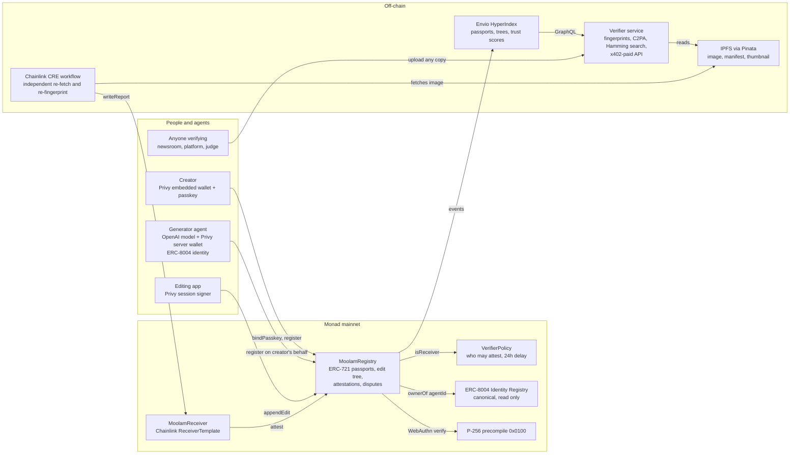
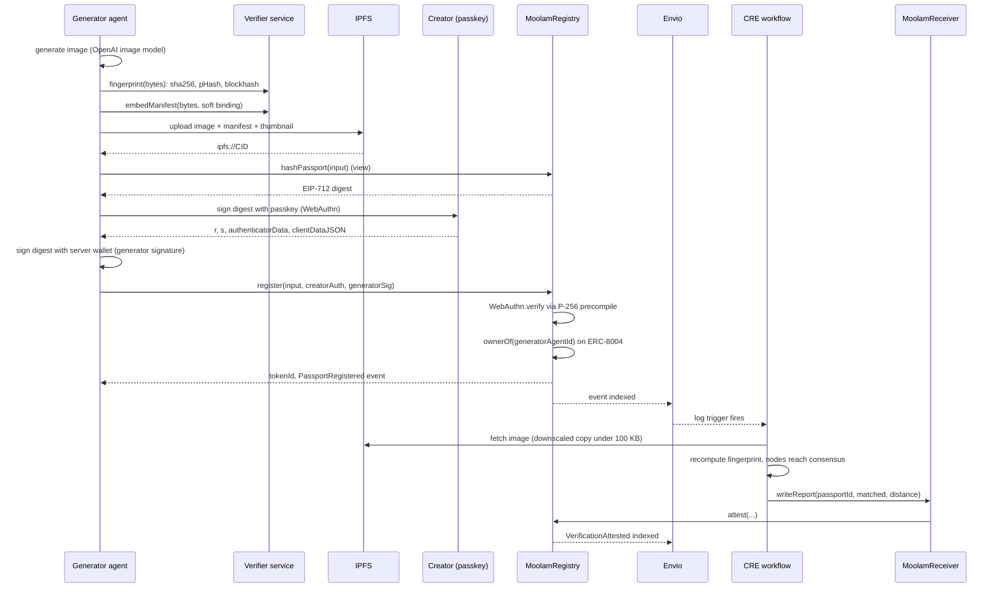
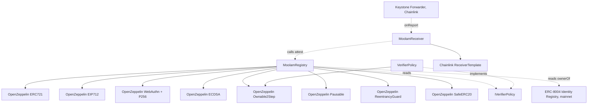
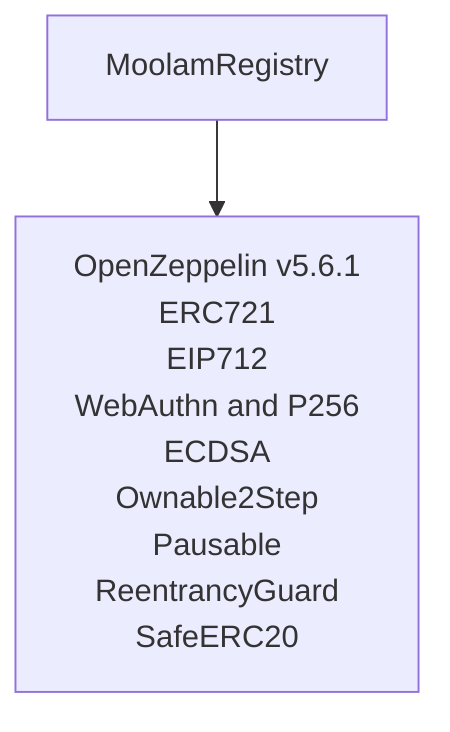
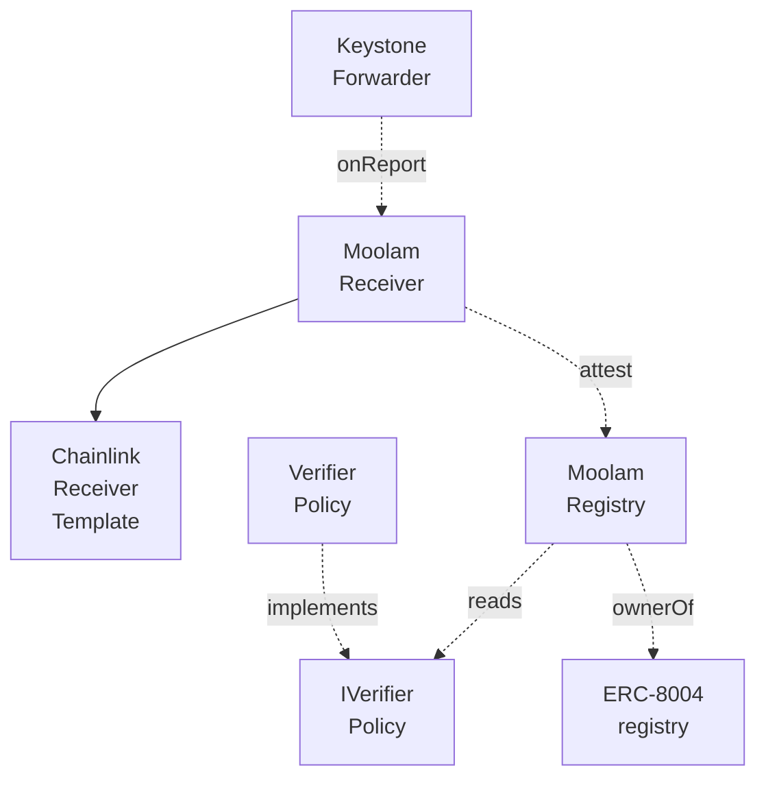

# Architecture

Three diagrams: what the pieces are, what happens when one image gets a passport, and what the
contracts depend on.

## System overview

Five people or programs touch the system and each one enters through a different door. The creator
binds a passkey and registers. The generator agent registers on the creator's behalf, with both
signatures. An editing app appends edits through a Privy session signer. Anyone verifying uploads a
copy to the verify service and never touches the chain at all. On chain, `MoolamRegistry` reads the
P-256 precompile for passkeys, the ERC-8004 Identity Registry for agent ownership, and
`VerifierPolicy` for who may attest. Off chain, the Chainlink CRE workflow re-fetches and
re-fingerprints, Envio indexes the events, and the verify service reads passports out of Envio.



```mermaid phone "Half one: who writes to the registry, and what the registry reads."
flowchart TD
    C[Creator<br/>passkey] -- register --> R[Moolam<br/>Registry]
    G[Generator<br/>agent] -- register --> R
    E[Editing<br/>app] -- appendEdit --> R
    R -- verify --> PC[P-256<br/>precompile]
    R -- ownerOf --> I8[ERC-8004<br/>registry]
    R -- isReceiver --> P[Verifier<br/>Policy]
```

```mermaid phone "Half two: the independent re-check and the readers, off chain."
flowchart TD
    R[Moolam<br/>Registry] -- events --> X[Envio<br/>index]
    X -- trigger --> W[CRE<br/>workflow]
    W -- fetches --> F[IPFS via<br/>Pinata]
    W -- writeReport --> RC[Moolam<br/>Receiver]
    RC -- attest --> R
    X -- GraphQL --> S[Verifier<br/>service]
    V[Anyone<br/>verifying] -- uploads --> S
```

## Main sequence: a generated image gets a passport and is verified

Everything before the `register` call is preparation that costs no gas: the fingerprint, the C2PA
manifest, the four IPFS pins, and the EIP-712 digest read back from the contract. Then two
signatures over that one digest, the creator's passkey and the agent owner's wallet, and one
transaction that checks both. The registration event is what wakes the Chainlink workflow, which
fetches the image itself, recomputes the fingerprint, reaches consensus and writes the result back
through `MoolamReceiver`.



```mermaid phone "Half one: everything before the transaction, off chain and free."
flowchart TD
    A1[Agent generates image] --> A2[Service fingerprints image]
    A2 --> A3[Service embeds manifest]
    A3 --> A4[IPFS pins files]
    A4 --> A5[Registry returns digest]
    A5 --> A6[Creator signs<br/>passkey]
    A5 --> A7[Agent owner signs]
```

```mermaid phone "Half two: one transaction, then the re-check that follows it."
flowchart TD
    B1[register, both signatures] --> B2[P-256 precompile checks]
    B2 --> B3[ERC-8004 owner checked]
    B3 --> B4[Passport minted]
    B4 --> B5[Envio indexes event]
    B5 --> B6[CRE workflow wakes]
    B6 --> B7[Re-fetch and re-fingerprint]
    B7 --> B8[Receiver writes report]
    B8 --> B9[Registry records attestation]
```

Verification of a copy later runs entirely off chain: anyone uploads a file to the service, the
service computes the eight rotated and mirrored fingerprints, searches the index, and returns the
best passport with its attestations, its edit chain and a confidence score.

## Contract dependency graph

`MoolamRegistry` is built out of OpenZeppelin v5.6.1 and reads two contracts it does not own. It
holds `IVerifierPolicy` as an immutable address set at deployment and Monad's ERC-8004 Identity
Registry the same way. `MoolamReceiver` inherits Chainlink's `ReceiverTemplate` verbatim, vendored
under `src/vendor/chainlink/` so it can be diffed against Chainlink's published source, and the
Keystone Forwarder is the only address allowed to call `onReport`.







## How the app reads the chain

Every chain read a page makes happens on the app's server, not in the browser, so one endpoint
answers for every visitor. Two endpoints can be named. `NEXT_PUBLIC_MONAD_RPC_URL` is the public
one and is the only address the browser is ever given. `MONAD_RPC_URL` is optional and secret: a
dedicated endpoint, such as a QuickNode one, whose address carries its own access token. When it is
set, the server tries it first and falls back to the public endpoint, so a rate-limited minute on
either side is a slower page rather than an error. It is read on the server only, it must be an
https URL or the app refuses to start, and the one line a page prints when a read fails has every
address taken out of it first.

## What is immutable and what can change

- `MoolamRegistry` has no upgrade path. Records, edits and attestations are only ever added. The
  owner can pause new writes and rescue tokens sent by mistake; the owner cannot edit or delete a
  passport.
- `VerifierPolicy` is the only mutable piece: the list of receivers allowed to attest, the dispute
  resolver, the treasury and the bond. Every change is queued and executes 24 hours later,
  publicly, except removing a receiver, which is immediate so a compromised verifier can be cut
  off.
- The ERC-8004 registry is Monad's canonical deployment. Moolam only reads it.

The exact function signatures, events and errors are in the
[API reference](../api/registry). ABIs live in `packages/contracts/abi/`.
