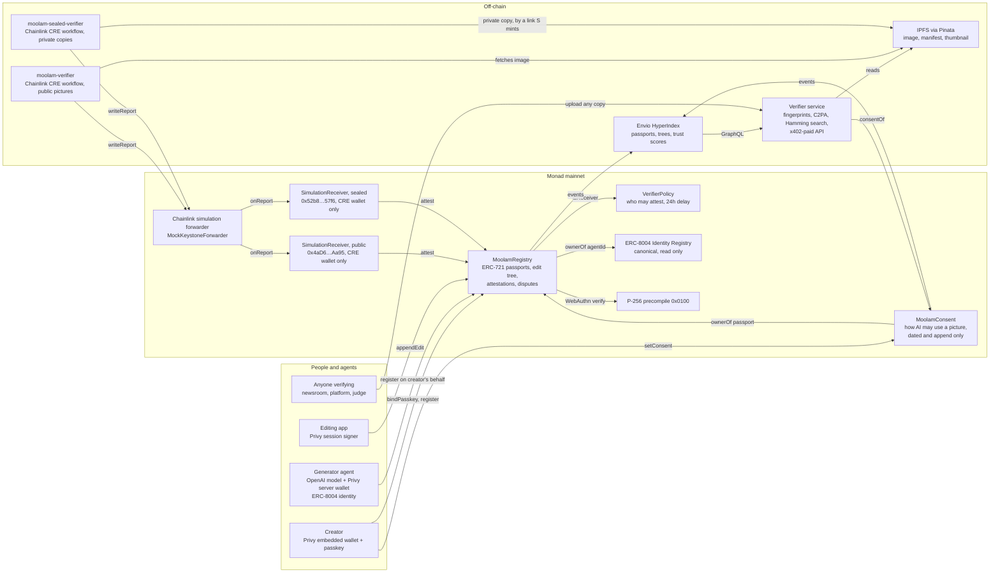
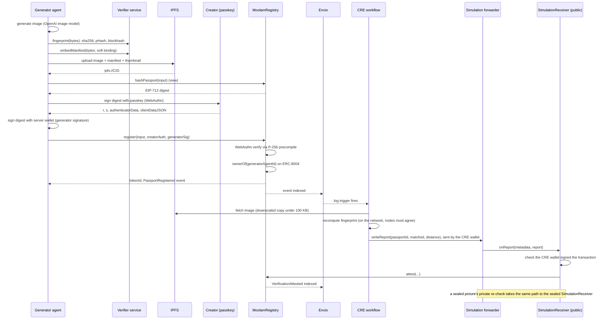
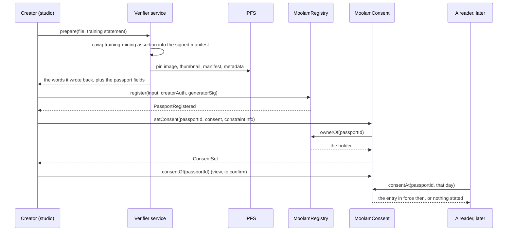
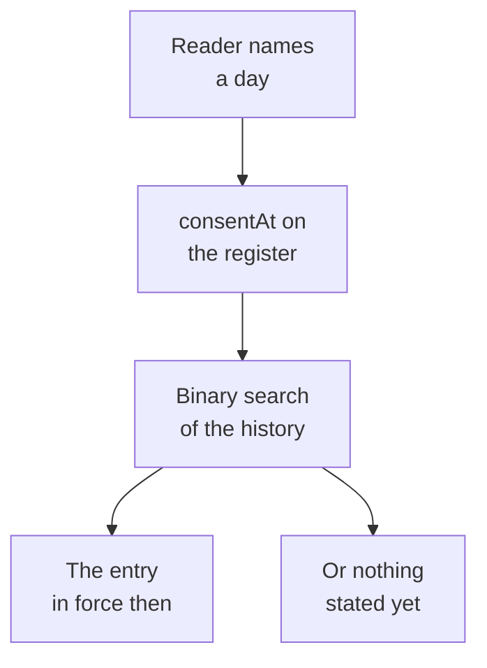
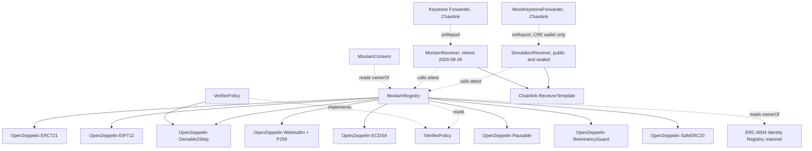

# Architecture

Three diagrams: what the pieces are, what happens when one image gets a passport, and what the
contracts depend on.

## System overview

Five people or programs touch the system and each one enters through a different door. The creator
binds a passkey and registers, and states how AI may use the picture. The generator agent registers
on the creator's behalf, with both signatures. An editing app appends edits through a Privy session
signer. Anyone verifying uploads a copy to the verify service and never touches the chain at all. On
chain, `MoolamRegistry` reads the P-256 precompile for passkeys, the ERC-8004 Identity Registry for
agent ownership, and `VerifierPolicy` for who may attest, while `MoolamConsent` reads the registry
for who holds a passport. Off chain, the Chainlink CRE workflow re-fetches and re-fingerprints,
Envio indexes the events, and the verify service reads passports out of Envio and statements
straight off the consent register.



```mermaid phone "Half one: who writes to the registry, and what the registry reads." height=470
flowchart TD
    C[Creator<br/>passkey] -- register --> R[Moolam<br/>Registry]
    G[Generator<br/>agent] -- register --> R
    E[Editing<br/>app] -- appendEdit --> R
    C -- setConsent --> MC[Moolam<br/>Consent]
    MC -- ownerOf --> R
    R -- verify --> PC[P-256<br/>precompile]
    R -- ownerOf --> I8[ERC-8004<br/>registry]
    R -- isReceiver --> P[Verifier<br/>Policy]
```

```mermaid phone "Half two: the independent re-check and the readers, off chain." height=412
flowchart TD
    R[Moolam<br/>Registry] -- events --> X[Envio<br/>index]
    X -- trigger --> W[CRE<br/>workflow]
    W -- fetches --> F[IPFS via<br/>Pinata]
    W -- writeReport --> MF[Simulation<br/>forwarder]
    MF -- onReport --> RC[Simulation<br/>Receiver, public]
    MF -- onReport --> RS[Simulation<br/>Receiver, sealed]
    RC -- attest --> R
    RS -- attest --> R
    X -- GraphQL --> S[Verifier<br/>service]
    S -- consentOf --> MC[Moolam<br/>Consent]
    V[Anyone<br/>verifying] -- uploads --> S
```

## Main sequence: a generated image gets a passport and is verified

Everything before the `register` call is preparation that costs no gas: the fingerprint, the C2PA
manifest, the four IPFS pins, and the EIP-712 digest read back from the contract. Then two
signatures over that one digest, the creator's passkey and the agent owner's wallet, and one
transaction that checks both. The registration event is what wakes the Chainlink workflow, which
fetches the image itself, recomputes the fingerprint and writes the result back through Chainlink's
simulation forwarder to the public `SimulationReceiver`, which takes it only in a transaction
Moolam's CRE wallet signed. The workflow is written so that on Chainlink's network a quorum of nodes must
produce the identical verdict before a report is signed. Every re-check on chain today came from
Chainlink's simulator with `--broadcast`, which is one machine and no consensus, and the passport
page labels each one by the forwarder that delivered it.



```mermaid phone "Half one: everything before the transaction, off chain and free." height=565
flowchart TD
    A1[Agent generates image] --> A2[Service fingerprints image]
    A2 --> A3[Service embeds manifest]
    A3 --> A4[IPFS pins files]
    A4 --> A5[Registry returns digest]
    A5 --> A6[Creator signs<br/>passkey]
    A5 --> A7[Agent owner signs]
```

```mermaid phone "Half two: one transaction, then the re-check that follows it." height=850
flowchart TD
    B1[register, both signatures] --> B2[P-256 precompile checks]
    B2 --> B3[ERC-8004 owner checked]
    B3 --> B4[Passport minted]
    B4 --> B5[Envio indexes event]
    B5 --> B6[CRE workflow wakes]
    B6 --> B7[Re-fetch and re-fingerprint]
    B7 --> B8[Simulation forwarder delivers]
    B8 --> B9[Public SimulationReceiver<br/>checks CRE wallet]
    B9 --> B10[Registry records attestation]
```

Verification of a copy later runs entirely off chain: anyone uploads a file to the service, the
service computes the eight rotated and mirrored fingerprints, searches the index, and returns the
best passport with its attestations, its edit chain and a confidence score.

## A statement about AI use, and the day query

A creator's answer to "may AI train on this" is written twice in the same minute and read back much
later. The service writes it into the signed C2PA manifest and the pinned metadata before the
passport exists, because a manifest is signed once and cannot be added to. The chain half waits
until the registration is confirmed, then goes out as a second sponsored transaction from the
creator's own wallet. If that second send fails, the passport stays registered and the statement can
be written later from the passport page.

The second half of the drawing is the question a label inside a file cannot answer. A reader asks
the register what was in force on a given day, and gets that day's entry rather than today's.



```mermaid phone "Half one: the statement, written into the file and then onto the chain." height=763
flowchart TD
    A1[Creator picks<br/>a statement] --> A2[Service writes<br/>the assertion]
    A2 --> A3[IPFS pins<br/>the metadata]
    A3 --> A4[Passport<br/>registered]
    A4 --> A5[Second send,<br/>sponsored]
    A5 --> A6[Register asks<br/>who holds it]
    A6 --> A7[ConsentSet<br/>emitted]
```



## Contract dependency graph

`MoolamRegistry` is built out of OpenZeppelin v5.6.1 and reads two contracts it does not own. It
holds `IVerifierPolicy` as an immutable address set at deployment and Monad's ERC-8004 Identity
Registry the same way. Both receiver contracts inherit Chainlink's `ReceiverTemplate` verbatim,
vendored under `src/vendor/chainlink/` so it can be diffed against Chainlink's published source. The
`SimulationReceiver` pair in use since 2026-09-27 takes `onReport` only from Chainlink's simulation
forwarder and only in a transaction Moolam's CRE wallet signed. The `MoolamReceiver` pair, retired
on 2026-09-26, took it from the Keystone Forwarder. `MoolamConsent` depends on
nothing but an `IERC721` view: it holds the registry address as an immutable set at deployment and
asks it `ownerOf`, which is the whole integration. The arrow points one way, so the registry does
not know the consent register exists.



```mermaid phone "Half one: what MoolamRegistry is built out of." height=409
flowchart TD
    MR[MoolamRegistry] --> OZ[OpenZeppelin v5.6.1<br/>ERC721<br/>EIP712<br/>WebAuthn and P256<br/>ECDSA<br/>Ownable2Step<br/>Pausable<br/>ReentrancyGuard<br/>SafeERC20]
```

```mermaid phone "Half two: what it reads, and who may write a re-check." height=465
flowchart TD
    MF[Simulation<br/>forwarder] -. onReport .-> SR[Simulation<br/>Receivers]
    SR --> RT[Chainlink<br/>Receiver<br/>Template]
    SR -. attest .-> MR[Moolam<br/>Registry]
    MR -. reads .-> IVP[IVerifier<br/>Policy]
    MR -. ownerOf .-> I8[ERC-8004<br/>registry]
    VP[Verifier<br/>Policy] -. implements .-> IVP
    MC[Moolam<br/>Consent] -. ownerOf .-> MR
```

## How the app reads the chain

Every chain read a page makes happens on the app's server, not in the browser, so one endpoint
answers for every visitor. Two endpoints can be named. `NEXT_PUBLIC_MONAD_RPC_URL` is the public
one and is the only address the browser is ever given. `MONAD_RPC_URL` is optional and secret: a
dedicated endpoint, such as a QuickNode one, whose address carries its own access token. When it is
set, the server tries it first and falls back to the public endpoint, so a rate-limited minute on
either side is a slower page rather than an error. It is read on the server only, it must be an
https URL or the app refuses to start, and the one line a page prints when a read fails has every
address taken out of it first.

## What is immutable and what can change

- `MoolamRegistry` has no upgrade path. Records, edits and attestations are only ever added. The
  owner can pause new writes and rescue tokens sent by mistake; the owner cannot edit or delete a
  passport.
- `MoolamConsent` has no upgrade path and no owner at all. Statements are only ever appended, so a
  new one supersedes an old one without hiding it, and nobody can pause it or take it back.
- `VerifierPolicy` is the only mutable piece: the list of receivers allowed to attest, the dispute
  resolver, the treasury and the bond. Every change is queued and executes 24 hours later,
  publicly, except removing a receiver, which is immediate so a compromised verifier can be cut
  off.
- The ERC-8004 registry is Monad's canonical deployment. Moolam only reads it.

The exact function signatures, events and errors are in the
[API reference](../api/registry). ABIs live in `packages/contracts/abi/`.
